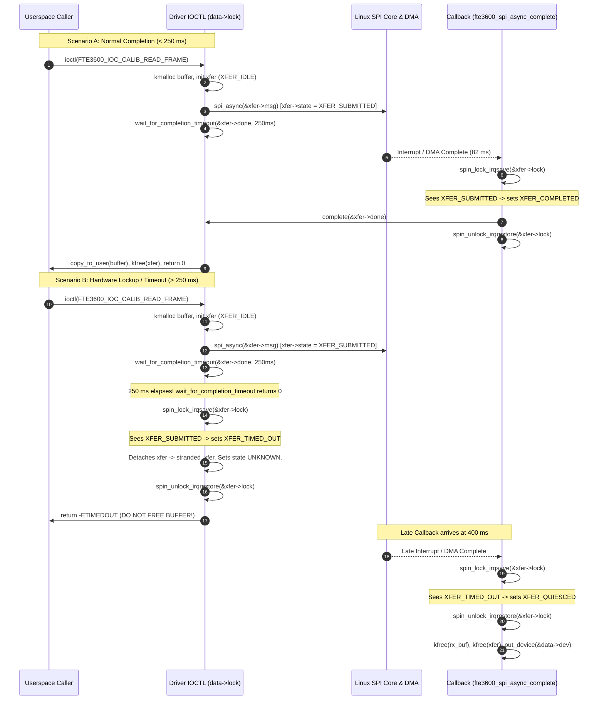

# Stage D7.7 — SPI Transaction State Machine & Serialization Audit

**Project:** `/home/titan/fte3600-linux-driver/`  
**Host Target:** Dynabook Satellite Pro C40-J (`PYS46G-06J02D`), FocalTech FT9362 / FW9369 (`spi-FTE3600:00`)  
**Scope:** Strictly Read-Only Concurrency & State Machine Architecture Audit  
**Deliverable:** `diagnostics/STAGE_D7_7_SPI_SERIALIZATION_AUDIT.md`  
**Date:** 2026-11-05  

---

## 1. Executive Summary & Objective

To implement asynchronous SPI transfers safely without risking double-completion, use-after-free, or overlapping bus access, the driver must maintain a formal transaction state machine.

This audit specifies the exact states, transitions, locking hierarchy, and callback sequence for managing asynchronous SPI operations.

---

## 2. Transaction State Machine Specification

### 2.1. Formal State Definitions
```c
enum fte3600_xfer_state {
    FTE3600_XFER_IDLE = 0,             /* No transaction active; bus idle */
    FTE3600_XFER_SUBMITTED = 1,        /* Enqueued via spi_async; hardware running */
    FTE3600_XFER_COMPLETED = 2,        /* Normal completion signaled before timeout */
    FTE3600_XFER_TIMED_OUT = 3,        /* Waiter timed out; transaction stranded in hardware */
    FTE3600_XFER_FAILED = 4,           /* Controller returned hardware error */
    FTE3600_XFER_DEVICE_REMOVING = 5,  /* Device unbind initiated; queue flushing */
    FTE3600_XFER_QUIESCED = 6          /* Teardown completed; resources freed */
};
```

### 2.2. Locking Hierarchy & Responsibility
1. **`mutex_lock(&data->lock)` (Sleepable Mutex):**
   - Serializes all ioctl entry points.
   - Prevents concurrent calls to `spi_async()`.
   - Protects device operational state (`data->state`) and session parameters.
2. **`spin_lock_irqsave(&xfer->lock, flags)` (Atomic Spinlock):**
   - Embedded inside each `struct fte3600_async_xfer`.
   - Protects atomic transitions of `xfer->state`.
   - Safe to acquire inside hardirq, tasklet, or kworker completion callbacks.
   - **Hierarchy Rule:** $\text{data}\to\text{lock} \prec \text{xfer}\to\text{lock}$. A thread holding `data->lock` may acquire `xfer->lock`. A callback holding `xfer->lock` **MUST NEVER** attempt to acquire `data->lock`.

---

## 3. Formal State Transition Matrix

| Initial State | Event Trigger | Next State | Context | Action Taken |
| :--- | :--- | :--- | :--- | :--- |
| `IDLE` | `spi_async()` called | `SUBMITTED` | Process (`data->lock`) | Enqueues message to controller queue |
| `SUBMITTED` | Callback fires (`status == 0`) | `COMPLETED` | Callback (Atomic) | Calls `complete(&xfer->done)` |
| `SUBMITTED` | Callback fires (`status < 0`) | `FAILED` | Callback (Atomic) | Records error; calls `complete(&xfer->done)` |
| `SUBMITTED` | Timeout expires (250 ms) | `TIMED_OUT` | Process (`data->lock`) | Detaches xfer; unblocks waiter; sets driver state `UNKNOWN` |
| `SUBMITTED` | Device unbind / remove | `DEVICE_REMOVING` | Process (`remove`) | Core flushes queue with `-ESHUTDOWN` |
| `TIMED_OUT` | Late completion callback | `QUIESCED` | Callback (Atomic) | Frees `xfer->rx_buf` and `xfer`; puts device ref |
| `DEVICE_REMOVING` | Flush callback fires | `QUIESCED` | Callback (Atomic) | Frees `xfer->rx_buf` and `xfer`; puts device ref |
| `COMPLETED` | Waiter consumes payload | `QUIESCED` | Process (`data->lock`) | `copy_to_user()`; frees `xfer->rx_buf` and `xfer` |

---

## 4. Callback Sequence Diagram



---

## 5. Overlapping & Stale Submission Prevention

### 5.1. Mutual Exclusion Guarantee
In `kernel/fte3600.c`:
```c
/* Inside any SPI submission ioctl: */
mutex_lock(&data->lock);

if (data->stranded_xfer != NULL) {
    /* A prior transaction timed out and is still unresolved on the bus */
    mutex_unlock(&data->lock);
    return -EBUSY;
}
```
- **Invariant:** A new SPI transaction **can never be submitted** while `data->stranded_xfer` is non-NULL.
- This prevents bus overlap, controller queue corruption, and DMA race conditions.
- Only when the late callback fires (or controller flush completes) does `data->stranded_xfer` clear, restoring bus accessibility.
