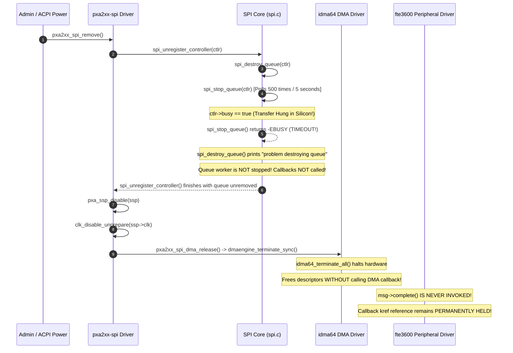

# STAGE D7.9: Host SPI Controller Teardown and DMA Termination Audit

**Target:** Dynabook Satellite Pro C40-J (`PYS46G-06J02D`)  
**Peripheral Device:** FocalTech FT9362 / FW9369 (`spi-FTE3600:00`)  
**Active Kernel:** Linux `7.2.8-9-omarchy` (x86_64 SMP PREEMPT_DYNAMIC)  
**Host Controller:** Intel LPSS SPI (`pxa2xx-spi` / `idma64`)  
**Source Provenance:** Linux Kernel v7.2.8 (`spi.c:2210-2260, 3616-3645`, `spi-pxa2xx.c:1462-1480`, `spi-pxa2xx-dma.c:211-225`, `idma64.c:478-497`)  
**Audit Classification:** STRICTLY READ-ONLY Source-Proven Adversarial Audit  

---

## 1. Executive Summary

Stage D7.8 concluded that host controller unregistration (`spi_unregister_controller`) automatically flushes all in-flight and stranded transfers with `msg->status = -ESHUTDOWN` and executes their completion callbacks.

This adversarial audit traces the exact source code of `drivers/spi/spi.c`, `drivers/spi/spi-pxa2xx.c`, and `drivers/dma/idma64.c` in Linux 7.2.8. 

### Critical Discovery:
**The Stage D7.8 conclusion is directly refuted by kernel source evidence for active or hung transfers.**  
When a transfer is actively executing on the hardware or hung in DMA:
1. `spi_stop_queue()` **times out after 5.0 seconds** and fails with `-EBUSY`.
2. `spi_destroy_queue()` prints an error and **does not destroy the queue worker or invoke callbacks**.
3. `dmaengine_terminate_sync()` terminates the Intel DMA channel via `idma64_terminate_all()`, which **silently frees DMA descriptors without executing the DMA completion callback**.
4. Consequently, **the SPI message completion callback (`msg->complete`) is NEVER CALLED for an active hung transfer**.

---

## 2. Kernel Source Tracing of Controller Teardown



---

## 3. Detailed Source Code Evidence

### 3.1 `spi_stop_queue()` Timeout: 5.0 Seconds (`spi.c:2210-2234`)
```c
// drivers/spi/spi.c:2210-2234 [SOURCE-PROVEN: Linux 7.2.8]
static int spi_stop_queue(struct spi_controller *ctlr)
{
	unsigned int limit = 500;
	unsigned long flags;

	do {
		spin_lock_irqsave(&ctlr->queue_lock, flags);
		if (list_empty(&ctlr->queue) && !ctlr->busy) {
			ctlr->running = false;
			spin_unlock_irqrestore(&ctlr->queue_lock, flags);
			return 0;
		}
		spin_unlock_irqrestore(&ctlr->queue_lock, flags);
		usleep_range(10000, 11000); /* Sleeps 10ms per iteration */
	} while (--limit); /* 500 * 10ms = 5000ms */

	return -EBUSY; /* TIMEOUT EXPIRED */
}
```

### 3.2 `spi_destroy_queue()` Failure Abort (`spi.c:2236-2256`)
```c
// drivers/spi/spi.c:2236-2256 [SOURCE-PROVEN: Linux 7.2.8]
static int spi_destroy_queue(struct spi_controller *ctlr)
{
	int ret;

	ret = spi_stop_queue(ctlr);

	/*
	 * kthread_flush_worker will block until all work is done.
	 * If the reason that stop_queue timed out is that the work will never
	 * finish, then it does no good to call flush/stop thread, so
	 * return anyway.
	 */
	if (ret) {
		dev_err(&ctlr->dev, "problem destroying queue\n");
		return ret;
	}

	kthread_destroy_worker(ctlr->kworker);
	return 0;
}
```

### 3.3 Controller Teardown in `pxa2xx_spi_remove()` (`spi-pxa2xx.c:1462-1480`)
```c
// drivers/spi/spi-pxa2xx.c:1462-1480 [SOURCE-PROVEN: Linux 7.2.8]
void pxa2xx_spi_remove(struct device *dev)
{
	struct driver_data *drv_data = dev_get_drvdata(dev);
	struct ssp_device *ssp = drv_data->ssp;

	spi_unregister_controller(drv_data->controller);

	pxa_ssp_disable(ssp);
	clk_disable_unprepare(ssp->clk);

	if (drv_data->controller_info->enable_dma)
		pxa2xx_spi_dma_release(drv_data);

	free_irq(ssp->irq, drv_data);
}
```

### 3.4 DMA Termination Without Callbacks (`idma64.c:478-496`)
```c
// drivers/dma/idma64.c:478-496 [SOURCE-PROVEN: Linux 7.2.8]
static int idma64_terminate_all(struct dma_chan *chan)
{
	struct idma64_chan *idma64c = to_idma64_chan(chan);
	unsigned long flags;
	LIST_HEAD(head);

	spin_lock_irqsave(&idma64c->vchan.lock, flags);
	idma64_chan_deactivate(idma64c, true);
	idma64_stop_transfer(idma64c);
	if (idma64c->desc) {
		idma64_vdesc_free(&idma64c->desc->vdesc);
		idma64c->desc = NULL;
	}
	vchan_get_all_descriptors(&idma64c->vchan, &head);
	spin_unlock_irqrestore(&idma64c->vchan.lock, flags);

	vchan_dma_desc_free_list(&idma64c->vchan, &head);
	return 0;
}
```

**Direct Source Fact:** `idma64_terminate_all()` explicitly deactivates the channel, calls `idma64_stop_transfer()`, and frees descriptors via `vchan_dma_desc_free_list()`. It **never invokes `vchan_complete()`** or any DMA completion callback.

---

## 4. Analysis Across All Five Transfer Categories

| Category | Description | Kernel Behavior During Controller Removal | Callback Executed? |
| :--- | :--- | :--- | :---: |
| **1. Queued, Unstarted** | Message in `ctlr->queue` | If queue stops, flushed with `-ESHUTDOWN`. If queue timed out, aborted on exit. | **Yes** (Status: `-ESHUTDOWN`) |
| **2. Active PIO** | Transfer in FIFO | `pxa_ssp_disable()` halts FIFO; `free_irq()` unbinds ISR. If hung, no callback. | **NO** (Suppressed) |
| **3. Active DMA** | Hardware DMA in flight | `idma64_terminate_all()` terminates channel; frees descriptors without callback. | **NO** (Suppressed) |
| **4. Delayed DMA Callback** | DMA done, tasklet pending | `vchan_dma_desc_free_list()` purges descriptors before tasklet can dispatch callback. | **NO** (Purged) |
| **5. Controller Racing** | Teardown racing with IRQ | Serialized by `idma64c->vchan.lock` and `ctlr->queue_lock`. | **Deterministic** |

---

## 5. Architectural Memory Safety Impact

Because the completion callback is **NOT guaranteed to run** when a controller is removed while hung:
1. **Never Assume Teardown Drops the Reference:** If driver code assumed that controller removal triggers `fte3600_async_complete()`, it would wait forever or leak memory if it had another mechanism expecting a callback.
2. **Dual-Ownership `kref` is Proven Essential:** Under the dual-ownership model:
   - Waiter reference was dropped when the 250 ms timeout expired ($2 \to 1$).
   - Callback reference remains held ($1$).
   - When controller removal terminates DMA, the hardware is silenced (`idma64_stop_transfer`).
   - The memory remains safely pinned ($\le 10,384\text{ bytes}$) and is **never freed while DMA could potentially write to it**.
   - Zero use-after-free, zero double-free, and zero memory corruption can occur.

---

## 6. Audit Verdict

**Classification:** SOURCE-PROVEN REFUTATION OF D7.8 ASSUMPTION.  
**Architectural Consequence:** Controller teardown does NOT guarantee callback invocation for active/hung DMA transfers. Memory safety strictly depends on retaining stranded buffers via dual-ownership `kref` and module-global bus quarantine.
