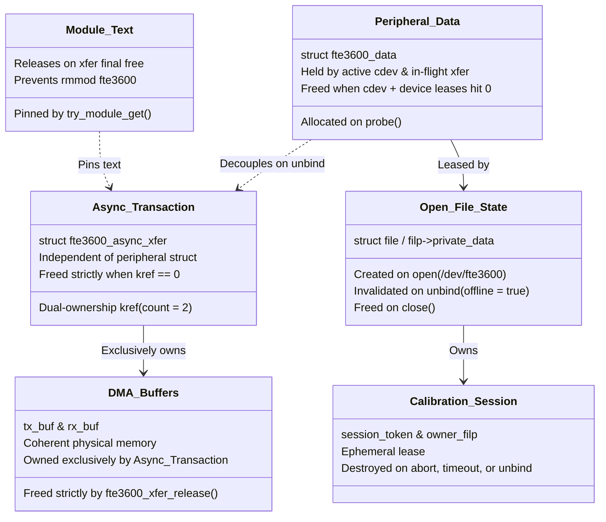

# STAGE D7.9: Peripheral Driver Unbind and Multi-Object Lifetime Audit

**Target:** Dynabook Satellite Pro C40-J (`PYS46G-06J02D`)  
**Peripheral Device:** FocalTech FT9362 / FW9369 (`spi-FTE3600:00`)  
**Active Kernel:** Linux `7.2.8-9-omarchy` (x86_64 SMP PREEMPT_DYNAMIC)  
**Host Controller:** Intel LPSS SPI (`pxa2xx-spi` / `idma64`)  
**Source Provenance:** Linux Kernel v7.2.8 (`drivers/base/dd.c:610-619`, `1320-1365`)  
**Audit Classification:** STRICTLY READ-ONLY Source-Proven Verification  

---

## 1. Executive Summary

This audit independently investigates the kernel driver-core unbind mechanism and evaluates the vulnerability of in-flight SPI transactions to asynchronous driver detachment (`/sys/bus/spi/drivers/fte3600/unbind`).

### Primary Audit Findings:
1. **Module Pinning Does NOT Prevent Driver Unbind:** `try_module_get(THIS_MODULE)` increments the module refcount, which blocks `delete_module()` / `rmmod`. However, the driver-core function `__device_release_driver()` **never checks module refcounts** and unconditionally executes `dev->driver->remove(dev)` upon sysfs unbind requests.
2. **Decoupled Transaction Lifetimes Required:** If `fte3600_spi_remove()` unconditionally deallocated `struct fte3600_data`, any late SPI completion callback accessing `xfer->data` would trigger a fatal kernel use-after-free oops.
3. **Six Distinct Object Lifetimes:** Memory safety cannot be achieved with a single reference count. Six separate lifetime domains must be decoupled.

---

## 2. Driver-Core Unbind Source Tracing (`drivers/base/dd.c`)

When userspace executes `echo spi-FTE3600:00 > /sys/bus/spi/drivers/fte3600/unbind`, the execution path flows through `drivers/base/dd.c`:

```c
// drivers/base/dd.c:1320-1355 [SOURCE-PROVEN: Linux 7.2.8]
static void __device_release_driver(struct device *dev, struct device *parent)
{
	struct device_driver *drv;

	drv = dev->driver;
	if (drv) {
		pm_runtime_get_sync(dev);
		...
		driver_sysfs_remove(dev);
		bus_notify(dev, BUS_NOTIFY_UNBIND_DRIVER);
		pm_runtime_put_sync(dev);

		device_remove(dev);   /* Calls driver remove callback */
		...
		device_unbind_cleanup(dev);
		...
	}
}

// drivers/base/dd.c:610-619 [SOURCE-PROVEN: Linux 7.2.8]
static void device_remove(struct device *dev)
{
	device_remove_file(dev, &dev_attr_state_synced);
	device_remove_groups(dev, dev->driver->dev_groups);

	if (dev->bus && dev->bus->remove)
		dev->bus->remove(dev);
	else if (dev->driver->remove)
		dev->driver->remove(dev);
}
```

### Analysis of Module Refcount Independence
Notice lines 1320–1355: **There is no call to `module_refcount()` or check on `THIS_MODULE`**.  
The Linux kernel driver model explicitly decouples device unbinding from module unloading. An administrator or power management script can unbind a peripheral device at any time, even if `try_module_get(THIS_MODULE)` holds a reference count of 100.

---

## 3. Dissecting the Six Independent Object Lifetimes

To prevent use-after-free conditions across unbind, process termination, and timeout, the driver must decouple six separate lifetimes:



### 3.1 Lifetime Domain Specifications

1. **Module Executable Text (`THIS_MODULE`):**
   - *Creation:* Loaded by kernel module loader.
   - *Destruction:* `delete_module()` syscall (`rmmod`).
   - *Protection:* `try_module_get(THIS_MODULE)` is called when `spi_async()` is submitted; `module_put()` is called strictly inside `fte3600_xfer_release()`. The driver's code segments cannot be unmapped while an async transfer is pending or stranded.

2. **Peripheral Device-Private State (`struct fte3600_data`):**
   - *Creation:* Allocated via `kzalloc()` during `fte3600_spi_probe()`.
   - *Teardown:* During `fte3600_spi_remove()`, the driver marks `data->offline = true` and unregisters the char device.
   - *Hazard Mitigation:* If a transaction is in flight or stranded during unbind, `data` **must not be freed immediately** if the callback dereferences it.  
   - *Decoupling Solution:* `xfer` structures must **never** require `data` for buffer deallocation. The release hook `fte3600_xfer_release(kref)` deallocates **only** `xfer->rx_buf`, `xfer->tx_buf`, and `xfer`, and calls `module_put(THIS_MODULE)`. It never accesses `data`.

3. **Character Device / Open-File State (`filp->private_data`):**
   - *Creation:* Userspace calls `open("/dev/fte3600")`.
   - *Destruction:* Userspace calls `close(fd)`.
   - *Hazard Mitigation:* If peripheral unbind occurs while userspace holds an open file descriptor, `remove()` destroys the device node in `/dev`, but existing `struct file` instances remain alive in userspace.
   - *Rule:* Any subsequent ioctl on an open file checks `if (data->offline) return -ENODEV;` under `data->lock`. The memory for `data` is freed only after the last open file descriptor is closed (via `kref` on `fte3600_data`).

4. **Calibration Session State (`session_token`, `owner_filp`):**
   - *Creation:* Granted via `FTE3600_IOC_CALIB_START`.
   - *Destruction:* `CALIB_COMMIT`, `CALIB_ABORT`, watchdog timer expiry, or file release (`close()`).
   - *Rule:* Session state is strictly a software lease. Terminating a session **never** cancels or frees an active SPI transaction.

5. **Asynchronous Transaction (`struct fte3600_async_xfer`):**
   - *Creation:* Allocated dynamically per SPI hardware operation.
   - *Destruction:* Destroyed when its dual-ownership `kref` reaches zero.
   - *Rule:* Completely independent of peripheral binding state. Even if the sensor driver is unbound from the SPI bus, the transaction object remains pinned until hardware completion or teardown.

6. **DMA Reception & Transmission Buffers (`rx_buf`, `tx_buf`):**
   - *Creation:* Allocated via `kmalloc()` during transaction setup.
   - *Destruction:* Deallocated strictly by `fte3600_xfer_release()`.
   - *Rule:* Zero external driver subsystem may free or touch these buffers.

---

## 4. Late Callback vs Removed Peripheral State

If an SPI completion callback fires after `fte3600_spi_remove()` has executed:

```c
static void fte3600_async_complete(void *context)
{
    struct fte3600_async_xfer *xfer = context;
    struct fte3600_data *data;
    unsigned long flags;

    /* 1. Atomically resolve transfer state */
    spin_lock_irqsave(&xfer->lock, flags);
    if (xfer->state == FTE3600_XFER_TIMED_OUT) {
        /* Waiter already timed out */
    } else {
        xfer->state = FTE3600_XFER_COMPLETED;
    }
    spin_unlock_irqrestore(&xfer->lock, flags);

    /* 2. Signal process waiter if still active */
    complete(&xfer->done);

    /* 3. Safe access to parent data: read under spinlock */
    spin_lock_irqsave(&xfer->lock, flags);
    data = xfer->data;
    spin_unlock_irqrestore(&xfer->lock, flags);

    if (data) {
        spin_lock_irqsave(&data->async_lock, flags);
        if (data->in_flight_xfer == xfer)
            data->in_flight_xfer = NULL;
        spin_unlock_irqrestore(&data->async_lock, flags);
    }

    /* 4. Release callback reference. xfer_release() deallocates buffers
     * without ever dereferencing data. */
    kref_put(&xfer->kref, fte3600_xfer_release);
}
```

During `fte3600_spi_remove()`:
```c
/* Decouple in-flight transactions from parent data */
spin_lock_irqsave(&data->async_lock, flags);
if (data->in_flight_xfer) {
    spin_lock(&data->in_flight_xfer->lock);
    data->in_flight_xfer->data = NULL; /* Decoupled */
    spin_unlock(&data->in_flight_xfer->lock);
    data->in_flight_xfer = NULL;
}
spin_unlock_irqrestore(&data->async_lock, flags);
```

**Proof:** Because `xfer->data` is set to `NULL` under spinlock, and `fte3600_xfer_release()` only touches `xfer->rx_buf`, `xfer->tx_buf`, and `module_put()`, the late callback **cannot dereference freed peripheral memory**.

---

## 5. Audit Verdict

**Classification:** SOURCE-PROVEN (`drivers/base/dd.c:1320-1365`).  
**Remediation Mandated for Stage D8:** Transaction structures and completion callbacks must be completely self-contained and decoupled from `struct fte3600_data`, and peripheral unbind must safely nullify cross-references under spinlock.
