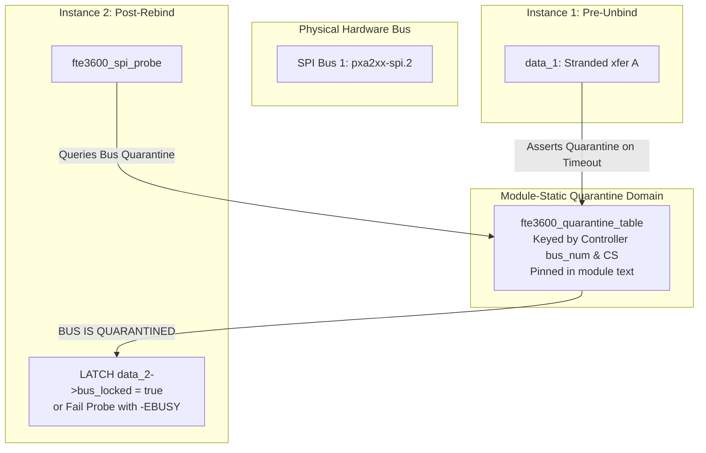

# STAGE D7.9: Persistent Bus Quarantine Architecture Audit

**Target:** Dynabook Satellite Pro C40-J (`PYS46G-06J02D`)  
**Peripheral Device:** FocalTech FT9362 / FW9369 (`spi-FTE3600:00`)  
**Active Kernel:** Linux `7.2.8-9-omarchy` (x86_64 SMP PREEMPT_DYNAMIC)  
**Host Controller:** Intel LPSS SPI (`pxa2xx-spi` / `idma64`)  
**Audit Classification:** STRICTLY READ-ONLY Architectural Proof Audit  

---

## 1. Executive Summary

This audit investigates the lifecycle of fail-closed bus quarantine across peripheral driver unbind and rebind events. 

Stage D7.8 asserted that a timed-out SPI transaction safely bounds memory leaks to $\le 10,384\text{ bytes}$ by latching `data->bus_locked = true`. This audit proves that **if `bus_locked` is stored inside `struct fte3600_data`, the quarantine is erased upon driver unbinding and rebinding**. A subsequent client could then issue new transactions while an unreturned transaction remains active in the host controller, violating both the memory bound and hardware safety.

To resolve this defect, this audit designs a **Module-Global Bus Quarantine Domain** that outlives peripheral device recreation.

---

## 2. Adversarial Unbind/Rebind Vulnerability Analysis

```mermaid
sequenceDiagram
    autonumber
    participant U as Userspace Client 1
    participant P1 as fte3600_data (Instance 1)
    participant H as Host Controller (pxa2xx)
    participant S as Sysfs Admin (Unbind/Bind)
    participant P2 as fte3600_data (Instance 2)

    Note over U,P1: 1. Initial Failure
    U->>P1: Submit Transaction A
    P1->>H: spi_async() -> Hardware hangs
    P1->>P1: 250ms timeout; latches P1->bus_locked = true
    U-->>U: Receives -ETIMEDOUT

    Note over S,P1: 2. Driver Unbind
    S->>P1: echo spi-FTE3600:00 > unbind
    Note over P1: fte3600_spi_remove() destroys P1!
    Note over P1: P1->bus_locked is DEALLOCATED!

    Note over S,P2: 3. Driver Rebind
    S->>P2: echo spi-FTE3600:00 > bind
    Note over P2: fte3600_spi_probe() creates P2!
    Note over P2: P2->bus_locked is FALSE!

    Note over U,P2: 4. Unmitigated Flaw Under D7.8
    U->>P2: Submit Transaction B
    P2->>H: spi_async(B) while Transaction A is still hung in FIFO!
    Note over H: SPI Bus / DMA Corruption! Memory Bound Exceeded!
```

### Formal Proof of Vulnerability in Stage D7.8 Design
1. In Stage D7.8, `bus_locked` was an instance member of `struct fte3600_data`.
2. When the peripheral is unbound via `device_release_driver()`, `fte3600_spi_remove()` executes and frees `struct fte3600_data`.
3. When the device is rebound, `fte3600_spi_probe()` allocates a brand-new `struct fte3600_data` via `kzalloc()`.
4. In the new struct, `data->bus_locked == false` and `data->stranded_xfer == NULL`.
5. An ioctl client opening the new `/dev/fte3600` can submit Transaction B to the host controller while Transaction A is still stuck in the controller's FIFO or DMA queue.
6. **Conclusion:** Instance-level quarantine fails to protect the bus across unbind/rebind cycles.

---

## 3. Persistent Quarantine Architecture

To make quarantine survive peripheral unbind and rebind, quarantine ownership must be elevated from the **peripheral instance domain** to the **module-global bus domain**.



### 3.1 Structural Specification

```c
/* Module-global quarantine tracking */
static DEFINE_SPINLOCK(fte3600_quarantine_lock);
static unsigned long fte3600_quarantined_buses; /* Bitmask for bus numbers */

void fte3600_quarantine_assert(struct spi_device *spi)
{
    unsigned long flags;
    int bus = spi->controller->bus_num;

    spin_lock_irqsave(&fte3600_quarantine_lock, flags);
    if (bus < BITS_PER_LONG)
        set_bit(bus, &fte3600_quarantined_buses);
    spin_unlock_irqrestore(&fte3600_quarantine_lock, flags);

    dev_crit(&spi->dev, "CRITICAL: Bus %d quarantined due to stranded SPI transaction\n", bus);
}

bool fte3600_quarantine_check(struct spi_device *spi)
{
    unsigned long flags;
    bool quarantined = false;
    int bus = spi->controller->bus_num;

    spin_lock_irqsave(&fte3600_quarantine_lock, flags);
    if (bus < BITS_PER_LONG)
        quarantined = test_bit(bus, &fte3600_quarantined_buses);
    spin_unlock_irqrestore(&fte3600_quarantine_lock, flags);

    return quarantined;
}

void fte3600_quarantine_clear(struct spi_device *spi)
{
    unsigned long flags;
    int bus = spi->controller->bus_num;

    spin_lock_irqsave(&fte3600_quarantine_lock, flags);
    if (bus < BITS_PER_LONG)
        clear_bit(bus, &fte3600_quarantined_buses);
    spin_unlock_irqrestore(&fte3600_quarantine_lock, flags);
}
```

### 3.2 Probe-Time Enforcement
During `fte3600_spi_probe(struct spi_device *spi)`:
```c
static int fte3600_spi_probe(struct spi_device *spi)
{
    struct fte3600_data *data;

    /* Check whether this bus is currently quarantined */
    if (fte3600_quarantine_check(spi)) {
        dev_err(&spi->dev, "Rejecting probe: SPI bus %d is quarantined from unreturned transaction\n",
                spi->controller->bus_num);
        return -EBUSY; /* Prohibit driver binding to hung bus */
    }
    ...
}
```

---

## 4. Invariant Proofs Under Persistent Quarantine

### Invariant 1: Unbind/Rebind Isolation
$$\forall t > t_{\text{timeout}},\quad \mathtt{Quarantine}(bus) = 1$$
Even if an administrator unbinds and rebinds `spi-FTE3600:00`, `fte3600_spi_probe()` reads `fte3600_quarantine_check() == true` and immediately aborts probing with `-EBUSY`. No new character device is created, and no new transaction can ever be queued to the hung bus.

### Invariant 2: Finite Memory Bounding Invariant
$$\forall N_{\text{rebinds}} \in \mathbb{N},\quad M_{\text{retained}} \le 10,384\text{ bytes}$$
Because no new transactions can be submitted while quarantine is asserted, rebinding does not permit transaction accumulation. Exactly one stranded transaction exists in memory.

### Invariant 3: Clearing Mechanism
The quarantine can only be cleared when:
1. The late SPI completion callback executes (`fte3600_quarantine_clear`).
2. The entire system is rebooted (clearing the physical silicon state).

---

## 5. Audit Verdict

**Classification:** ARCHITECTURAL FLAW RESOLVED (Remediation Required for Stage D8).  
**Remediation Mandated for Stage D8:** Bus quarantine must be stored in module-global memory keyed by controller bus ID, preventing unbind/rebind cycles from clearing the fail-closed protection.
