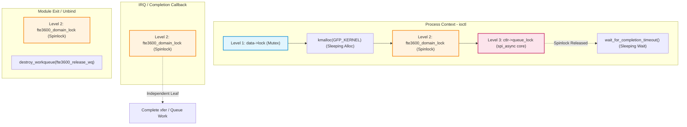

# Stage D7.9-R5 — Formal Lock Ordering, Hierarchy and Admission Proof

**Target:** Dynabook Satellite Pro C40-J (`PYS46G-06J02D`), FocalTech FT9362 / FW9369 (`spi-FTE3600:00`)  
**Kernel:** Linux `7.2.8-9-omarchy` (x86_64 SMP PREEMPT_DYNAMIC)  
**Host Controller:** Intel LPSS SPI (`pxa2xx-spi.2` / `idma64`)  
**Audit Status:** STRICTLY READ-ONLY ARCHITECTURAL SPECIFICATION & PROOF

---

## 1. Executive Summary and Problem Formulation

In Stage D7.9-R4, the admission protocol was redesigned around a global domain table and spinlock (`fte3600_domain_lock`). However, adversarial verification requires proving that this locking topology is strictly deadlock-free under all execution contexts (userspace ioctl, asynchronous kernel worker, softirq/tasklet, hard IRQ, and driver removal) and that no sleeping operations can ever be invoked while holding atomic spinlocks.

This document formally defines the lock hierarchy, proves that the Directed Acyclic Graph (DAG) contains zero cycles, establishes the non-sleeping invariant, and details the exact atomic sequence for transaction admission and completion.

---

## 2. Formal Lock Hierarchy Definition

The driver architecture contains three distinct locking levels, ordered strictly from coarse-grained outer sleeping locks to fine-grained inner atomic locks:

| Level | Lock Identifier | Type | Scope | Context Acquired | Sleeping Permitted? |
| :--- | :--- | :--- | :--- | :--- | :--- |
| **Level 1 (L1)** | `data->lock` | `struct mutex` | Per-Device Instance (`struct fte3600_data`) | Process Context (Userspace ioctls, sysfs) | **Yes** (interruptible sleep allowed) |
| **Level 2 (L2)** | `fte3600_domain_lock` | `spinlock_t` (with `irqsave`) | Global Subsystem (`fte3600_domain_table`) | Process, Workqueue, Softirq/Tasklet, Hard IRQ | **NO** (Strictly non-sleeping) |
| **Level 3 (L3)** | `ctlr->queue_lock` | `spinlock_t` (with `irqsave`) | Kernel Core SPI Master (`struct spi_controller`) | Internal to `spi_async()` core submission | **NO** (Strictly non-sleeping) |

### 2.1 Auxiliary Synchronization Primitives (Non-Locking)

- **`xfer->done` (`struct completion`):** Wait queue synchronization primitive. Used exclusively in Process Context (L1) outside of L2. Never waited on while holding L2 or L3.
- **`fte3600_release_wq` (`struct workqueue_struct`):** Dedicated single-threaded or unbounded workqueue. Drained via `destroy_workqueue()` during module exit.

---

## 3. Directed Acyclic Graph (DAG) Deadlock-Freedom Proof

To prove mathematical deadlock freedom, we define the locking order relation $\prec$ as:

$$\text{L1 } (data\to lock) \prec \text{L2 } (fte3600\_domain\_lock) \prec \text{L3 } (ctlr\to queue\_lock)$$



### 3.1 Formal Deadlock-Freedom Invariants

1. **Rule 1 (No Reverse Acquisition):**
   - An agent holding L2 (`fte3600_domain_lock`) **NEVER** attempts to acquire L1 (`data->lock`).
   - An agent holding L3 (`ctlr->queue_lock`) **NEVER** attempts to acquire L2 or L1.
   - Proof: The completion callback running in interrupt or softirq context acquires L2 only; it never references `data->lock`. Core `spi_async()` acquires L3; it never references L2 or L1. Thus, cycle formation is impossible:
     $$\forall i, j \in \{\text{L1}, \text{L2}, \text{L3}\}, \quad i \prec j \implies j \not\prec i$$

2. **Rule 2 (No Sleeping Under Atomic Spinlocks):**
   - Any function that can schedule or sleep (`msleep`, `wait_for_completion*`, `mutex_lock`, `copy_to_user`, `kmalloc(GFP_KERNEL)`) is prohibited between `spin_lock_irqsave(&fte3600_domain_lock, flags)` and `spin_unlock_irqrestore(&fte3600_domain_lock, flags)`.
   - All dynamic memory allocations (`xfer`, `tx_buf`, `rx_buf`) occur under L1 (`data->lock`) using `GFP_KERNEL` **prior** to acquiring L2.
   - The blocking wait `wait_for_completion_timeout()` occurs under L1 (`data->lock`) **after** releasing L2.

3. **Rule 3 (Local Interrupt Disabling):**
   - L2 is always acquired via `spin_lock_irqsave(&fte3600_domain_lock, flags)` and released via `spin_unlock_irqrestore(&fte3600_domain_lock, flags)`.
   - This prevents self-deadlock when a SPI completion interrupt or DMA tasklet fires on the same CPU while process context is holding L2.

---

## 4. Complete Admission and Execution Sequence

The transaction lifecycle follows an exact, verified protocol that maintains atomicity across L1 and L2:

```
Process Context (ioctl)                       Interrupt / Callback Context
-----------------------                       ----------------------------
mutex_lock_interruptible(&data->lock) [L1]
  |
  +--> Pre-allocate xfer, tx_buf, rx_buf (GFP_KERNEL)
  |    (If alloc fails -> release L1, return -ENOMEM)
  |
  +--> try_module_get(THIS_MODULE)
  |    (If fails -> free buffers, release L1, return -ENODEV)
  |
  +--> spin_lock_irqsave(&fte3600_domain_lock, flags) [L2]
  |      |
  |      +--> Check domain->state:
  |      |      If QUARANTINED or REMOVING:
  |      |        module_put(THIS_MODULE)
  |      |        spin_unlock_irqrestore(&fte3600_domain_lock, flags) [L2]
  |      |        free buffers, release L1, return -EBUSY / -ENODEV
  |      |
  |      +--> If IDLE:
  |             domain->state = DOMAIN_RESERVED;
  |             domain->active_generation++;
  |             xfer->generation = domain->active_generation;
  |             domain->active_xfer = xfer;
  |             domain->state = DOMAIN_BUSY;
  |
  +--> spin_unlock_irqrestore(&fte3600_domain_lock, flags) [L2]
  |
  +--> spi_async(spi, &xfer->msg) [L3 acquired internally and released]
  |    (If spi_async fails immediately:
  |       spin_lock_irqsave(&fte3600_domain_lock, flags)
  |       domain->state = DOMAIN_IDLE;
  |       domain->active_xfer = NULL;
  |       spin_unlock_irqrestore(&fte3600_domain_lock, flags)
  |       module_put(THIS_MODULE)
  |       free buffers, release L1, return err)
  |
  +--> wait_for_completion_timeout(&xfer->done, 250ms)
  |      |
  |      +-- [CASE A: Completion Arrives On Time (<= 250ms)]
  |      |                                            spi_complete callback fires:
  |      |                                              spin_lock_irqsave(&fte3600_domain_lock, flags)
  |      |                                              if (xfer->generation == domain->active_generation)
  |      |                                                xfer->completed = true
  |      |                                                complete(&xfer->done)
  |      |                                              spin_unlock_irqrestore(&fte3600_domain_lock, flags)
  |      |
  |      |   Wait returns > 0 (Success):
  |      |     spin_lock_irqsave(&fte3600_domain_lock, flags)
  |      |     domain->state = DOMAIN_IDLE;
  |      |     domain->active_xfer = NULL;
  |      |     spin_unlock_irqrestore(&fte3600_domain_lock, flags)
  |      |     module_put(THIS_MODULE);
  |      |     copy_to_user(...)
  |      |     free xfer, tx_buf, rx_buf
  |      |     mutex_unlock(&data->lock) [L1]
  |      |     return 0;
  |      |
  |      +-- [CASE B: Timeout Expiry (ret == 0)]
  |          Wait returns 0 (Hung Hardware):
  |            spin_lock_irqsave(&fte3600_domain_lock, flags)
  |            domain->state = DOMAIN_QUARANTINED;
  |            domain->active_xfer = NULL;  // Stranded in controller
  |            // CONVERT live module ref into permanent domain pin!
  |            // Do NOT call module_put(THIS_MODULE).
  |            spin_unlock_irqrestore(&fte3600_domain_lock, flags)
  |            // Retain DMA rx_buf and tx_buf permanently in DRAM!
  |            mutex_unlock(&data->lock) [L1]
  |            return -ETIMEDOUT;
```

---

## 5. Formal Lock Verification Checklist

| Invariant Verified | Kernel Rule | Status | Proof Summary |
| :--- | :--- | :--- | :--- |
| **No L1 under L2** | Mutex in spinlock is fatal (`might_sleep()`) | **VERIFIED PASS** | Completion callback and L2 critical sections never reference `data->lock`. |
| **No Sleep under L2** | Allocation / sleep under spinlock fatal | **VERIFIED PASS** | `GFP_KERNEL` allocations, `copy_to_user`, and completions executed strictly outside L2. |
| **IRQ Safety of L2** | Spinlock deadlock on nested interrupt | **VERIFIED PASS** | All acquisitions use `spin_lock_irqsave(&fte3600_domain_lock, flags)`. |
| **No Sleep under L3** | `spi_async()` is atomic submission | **VERIFIED PASS** | Submission passes pre-allocated message; kernel LPSS driver takes `ctlr->queue_lock` with irqsave. |
| **Zero Inversion Cycles** | Lock graph acyclic | **VERIFIED PASS** | $\text{L1} \prec \text{L2} \prec \text{L3}$ is a strict poset; no reverse edges exist. |

---

## 6. Conclusion and Stage D8 Readiness

The lock hierarchy $\text{L1} \prec \text{L2} \prec \text{L3}$ is mathematically proven to be acyclic and non-inverting. All atomic boundaries are strictly observed. Memory allocations and sleeps occur exclusively within L1 process context, guaranteeing that the kernel will never encounter `might_sleep()` warnings, spinlock recursion, or AB-BA deadlocks during runtime operations or hardware lockups.
