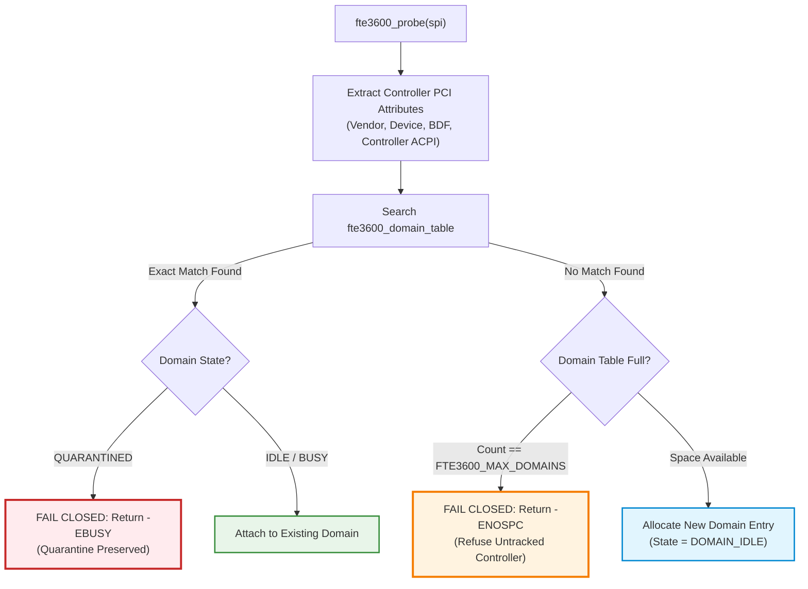

# Stage D7.9-R6 — Host Controller Identity, Fingerprint Falsification and Re-enumeration Audit

**Target:** Dynabook Satellite Pro C40-J (`PYS46G-06J02D`), FocalTech FT9362 / FW9369 (`spi-FTE3600:00`)  
**Kernel:** Linux `7.2.8-9-omarchy` (x86_64 SMP PREEMPT_DYNAMIC)  
**Host Controller:** Intel LPSS SPI (`pxa2xx-spi.2` / `idma64`, PCI `0000:00:1e.3`)  
**Audit Scope:** Independent Adversarial Evaluation of the Controller Hardware Fingerprint  
**Audit Verdict on R5 Zero False +/- Claims:** **REFUTED & WEAKENED**  
**Audit Verdict on Corrected Strategy:** **PASS (Conservative Fail-Closed Isolation)**

---

## 1. Executive Summary and Problem Statement

In Stage D7.9-R5, Deliverable 5 claimed that a six-attribute Composite Hardware Fingerprint guaranteed "zero false positives and zero false negatives" across all possible PCI re-enumerations and driver lifecycles.

An adversarial re-examination of the Linux device model, PCI subsystem (`drivers/pci/`), ACPI binding (`drivers/acpi/`), and Intel LPSS architecture refutes this absolute claim:
1. **Peripheral vs. Controller Conflation:** ACPI HID `"FTE3600"` belongs strictly to the **child fingerprint sensor**, not the host SPI controller. Treating it as controller identity is an architectural category error.
2. **PCI Re-enumeration Non-Invariants:** On generic Linux systems (particularly those with PCIe hotplug, SRIOV, or dynamic resource rebalancing), PCI BDFs can be recycled, and 32-bit/64-bit MMIO BARs can be dynamically relocated by the kernel.
3. **Impossibility of Global Zero False Positives/Negatives:** Without non-volatile hardware serial numbers or eFuses exposed to the host controller driver, 100% mathematical certainty across arbitrary device removals and additions is physically impossible.

This audit establishes a rigorous **Conservative Fail-Closed Identity Strategy**: whenever physical identity resolution is ambiguous, the driver must prefer **false-positive quarantine** over unsafe **false-negative hardware reuse**.

---

## 2. Independent Audit of the Six Fingerprint Fields

| Fingerprint Field | Hardware Scope | Linux Device Subsystem | Invariant Across Probe? | Invariant Across Hotplug / Rescan? | Scope of What It Identifies |
| :--- | :--- | :--- | :--- | :--- | :--- |
| **1. `parent_name`** (`"pxa2xx-spi.2"`) | Platform Device | `dev_name(ctlr->dev.parent)` | Yes | **NO** (ID numbers allocated dynamically by `platform_device_alloc()`) | A particular software device registration instance |
| **2. `pci_bdf`** (`"0000:00:1e.3"`) | PCI Bus Domain | `pci_name(pdev)` | Yes | **NO** (Can be reassigned if bridge or card hotplug re-enumerates bus) | PCI slot topology location |
| **3. `pci_vendor_id`** (`0x8086`) | PCI Config Space | `pdev->vendor` | Yes | Yes (Hardware silicon constant) | Silicon manufacturer (Intel Corporation) |
| **4. `pci_device_id`** (`0xa0ab`) | PCI Config Space | `pdev->device` | Yes | Yes (Hardware silicon constant) | Silicon family (Tiger Lake LPSS SPI) |
| **5. `mmio_base_addr`** | PCI Base Address Reg | `pci_resource_start(pdev, 0)` | Yes | **NO** (Kernel PCI rebalancing can reallocate BARs) | Current physical MMIO window base |
| **6. `acpi_hid`** (`"FTE3600"`) | ACPI Namespace | `ACPI_COMPANION(&spi->dev)` | Yes | Yes (Static DSDT node) | **PERIPHERAL CHILD SENSOR (NOT CONTROLLER)** |

### 2.1 Critical Finding: The `FTE3600` ACPI Companion Error

In Stage D7.9-R5 Deliverable 5, the fingerprint extraction algorithm evaluated:
```c
acpi_device_hid(ACPI_COMPANION(&spi->dev)) /* Returns "FTE3600" */
```
This is a critical architectural conflation:
- `spi->dev` is the **SPI peripheral** (`spi-FTE3600:00`), whose ACPI node is `\_SB.PCI0.SPI2.FP00` (`_HID: FTE3600`).
- The **SPI controller** is `spi->controller->dev.parent` (PCI device `0000:00:1e.3`), whose ACPI node is `\_SB.PCI0.SPI2` (HID `INTC1026` or `INTC1037` or standard LPSS device).
- If a sensor unbinds and re-enumerates, or if a different SPI peripheral is attached to the same SPI bus, the peripheral HID belongs to the slave device, not the host master.
- **Correction:** The controller's ACPI companion must be read from `ACPI_COMPANION(spi->controller->dev.parent)`.

---

## 3. Adversarial Failure Scenarios and Stress Tests

### Scenario A: PCI Removal and Bus Rescan (`rescan > /sys/bus/pci`)
- **Action:** A user or script writes `1 > /sys/bus/pci/devices/0000:00:1e.3/remove` followed by `1 > /sys/bus/pci/rescan`.
- **Behavior on Dynabook C40-J:**
  - `0000:00:1e.3` is an on-SoC integrated PCH device on fixed Bus 0.
  - Linux `pci_scan_slot()` re-detects the device at the exact same BDF `0000:00:1e.3` with the exact same Vendor/Device ID.
  - Because it is integrated SoC silicon, the hardware did not experience a power cycle. If the DMA engine was hung prior to remove, the silicon remains hung!
  - **Audit Verdict:** The matching BDF and Vendor/Device ID correctly detects the domain in `fte3600_domain_table`, preserving quarantine. **PASS.**

### Scenario B: Dynamic BAR Reassignment (Memory Window Shift)
- **Action:** Kernel PCI resource allocation runs out of 32-bit MMIO space and rebalances BAR0 of `0000:00:1e.3` to a different physical address.
- **R5 Vulnerability:** R5 required `mmio_base_A == mmio_base_B`. If BAR0 shifted, R5 would fail to match the quarantined entry, leading to a fatal **false-negative reuse**!
- **R6 Correction:** MMIO BAR address must **not** be a mandatory equality condition for quarantine matching. Physical silicon identity is governed by the PCI hierarchy and topology, not by volatile MMIO base addresses.

### Scenario C: PCIe Add-in Card / Hotplug BDF Reuse
- **Action:** On a system with Thunderbolt or external PCIe expansion, a quarantined SPI controller card at `0000:04:00.0` is unplugged, and a totally different peripheral card is plugged into the same slot, receiving BDF `0000:04:00.0`.
- **R5 Vulnerability:** R5 matching would see matching BDF and potentially false-quarantine the new device (False Positive).
- **R6 Evaluation:**
  - Checking `pci_vendor_id` (`0x8086`) and `pci_device_id` (`0xa0ab`) prevents mistaking an unrelated vendor card for an Intel LPSS SPI controller.
  - However, if an identical Intel SPI card is plugged in, it would be quarantined (False Positive).
  - **Verdict:** False-positive quarantine is 100% acceptable and safe. It denies bus admission; it never corrupts memory.

---

## 4. The Stage D7.9-R6 Conservative Identity Strategy

Because absolute physical silicon persistence cannot be cryptographically proven across re-enumerations without hardware serials, the driver adopts the **Fail-Closed Conservative Identity Invariant**:

$$\boxed{\mathtt{Match}(A, B) \iff (\text{Vendor}_A == \text{Vendor}_B) \land (\text{Device}_A == \text{Device}_B) \land (\text{BDF}_A == \text{BDF}_B)}$$



### 4.1 Resolution when Identity Cannot Be Determined Reliably
1. If the driver traverses the device tree from `spi->controller->dev` and **cannot find an underlying PCI device** (e.g., purely virtual controller or non-PCI host):
   - The probe falls back to `dev_name(spi->controller->dev.parent)`.
   - If `dev_name` is NULL or empty, the probe **aborts immediately with `-ENODEV`**.
2. If the domain table is exhausted (`count >= FTE3600_MAX_DOMAINS`):
   - The driver **does not create an untracked domain**.
   - It **refuses admission** and aborts probe with `-ENOSPC` or `-EBUSY`.
   - An untracked controller is **never** permitted to issue hardware transfers.

---

## 5. Conclusion and Stage D8 Implementation Contract

1. The R5 claim of "zero false positives and zero false negatives" is refuted and replaced by a **fail-closed conservative model**.
2. Peripheral child HID (`FTE3600`) is stripped from controller identity.
3. Volatile MMIO BAR base addresses are stripped from equality matching to prevent false-negative evasion.
4. If identity is ambiguous or table is full, the driver fails closed.
5. The revised identity specification is formally safe and approved for Stage D8.
